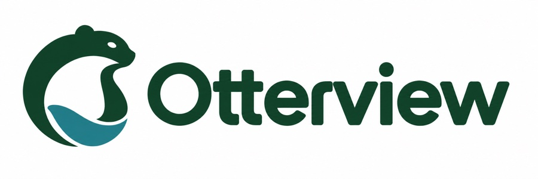

  

# Otterview Labs

We build AI vision software for model training and deployment, alongside open-source developer tools. Based in Chongqing, China.

[Website](https://otterview.ai/) · [Technical articles](https://otterview-labs.github.io/) · [中文](https://github.com/otterview-labs/.github/blob/main/profile/README.zh-CN.md)

## Open-source projects

| Project | What it does | Start here |
| --- | --- | --- |
| [SightIndex](https://github.com/otterview-labs/SightIndex) | Index and search images, videos and camera streams. | [First run](https://github.com/otterview-labs/SightIndex/blob/main/docs/first-run.md) |
| [agentBridge](https://github.com/otterview-labs/agentBridge) | Follow and reply to coding-agent sessions from an Android phone. | [Android releases](https://github.com/otterview-labs/agentBridge/releases) |
| [AgentHarbor](https://github.com/otterview-labs/agentharbor) | Run local coding tasks with separate execution and review. Desktop alpha. | [Desktop guide](https://github.com/otterview-labs/agentharbor/blob/main/docs/desktop-alpha.md) |
| [DocuGen](https://github.com/otterview-labs/DocuGen) | Search source material, fill Word templates and generate documents. | [Setup and usage](https://github.com/otterview-labs/DocuGen/blob/main/README.en.md) |

See the [project index](https://github.com/otterview-labs/.github/blob/main/profile/PROJECTS.md) for requirements, current scope and licenses. SightIndex results need human review; AI features in these projects require the relevant model services.

## Model training and deployment

[Lutrio](https://otterview.ai/training-platform) brings data preparation, assisted annotation and CV/VLM training workflows into one project. Its overseas environment currently provides invited sign-in; complete training execution is not open yet. See the product page for availability.

aibox combines CV detection and vision-language model review for on-site video analysis. We develop the software and model integrations.

For software support, open an issue in the relevant repository. Documentation fixes and pull requests are welcome. For product evaluation, [contact Otterview](https://otterview.ai/contact?source=github&utm_campaign=org-profile#evaluation-form).
