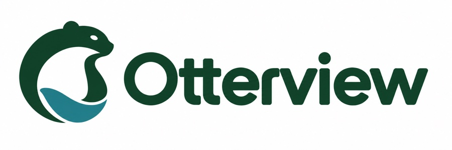

  

# Otterview Labs

我们在重庆，开发模型训练与部署应用所需的 AI 视觉软件，也维护开源开发工具。

[公司官网](https://otterview.ai/zh/) · [技术文章](https://otterview-labs.github.io/zh/) · [English](https://github.com/otterview-labs/.github/blob/main/profile/README.md)

## 在线体验

| 项目 | 可以试什么 | 入口 |
| --- | --- | --- |
| [SightIndex](https://github.com/otterview-labs/SightIndex) | 按标签找人，打开裁剪图和原图核对。 | [检索公开样例](http://43.153.213.96/search) |
| [DocuGen](https://github.com/otterview-labs/DocuGen) | 选一份 Word 模板，填入内容并下载文档。 | [打开模板库](https://docugen.otterview.ai/templates?source=builtin) |

## 开发者工具

- [agentBridge](https://github.com/otterview-labs/agentBridge)：在 Android 手机上查看和回复 Codex、Claude Code 会话。[下载安卓版](https://github.com/otterview-labs/agentBridge/releases)
- [AgentHarbor](https://github.com/otterview-labs/agentharbor)：在桌面运行本地编程任务，由不同助手负责实现和审核。[桌面 Alpha 使用说明](https://github.com/otterview-labs/agentharbor/blob/main/docs/desktop-alpha.md)

[项目索引](https://github.com/otterview-labs/.github/blob/main/profile/PROJECTS.zh-CN.md)还收录了独立文档检索工具和 AMD 图像服务，并列出各项目的配置要求与许可证。

## 模型训练与部署

[Lutrio](https://otterview.ai/zh/training-platform) 在同一个项目里管理数据准备、辅助标注和 CV/VLM 模型训练流程。目前海外环境提供受邀登录，完整训练执行尚未开放，具体开放范围见产品页。

aibox 结合 CV 检测与视觉语言模型复核，用于现场视频分析。我们主要开发软件与模型适配。

使用问题请提交到对应仓库的 Issues，文档补充与代码改进欢迎提交 Pull Request。产品评估可[联系 Otterview](https://otterview.ai/contact?source=github&utm_campaign=org-profile#evaluation-form)。
